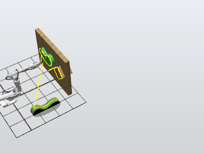
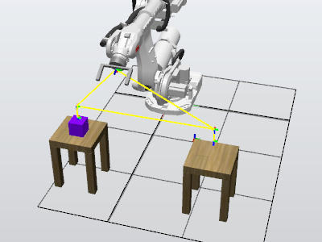

# Robot Programming with ABB RobotStudio

Two individual projects covering robot trajectory planning and sensor-based pick-and-place in ABB RobotStudio. I created the robot cells, configured tools and WorkObjects, and developed paths and handling logic for an **ABB IRB 6650S-125/3.5** robot.

**Author:** Martyna Rydczak (Mirgi)  
**Poznan University of Technology**

**RobotStudio · RAPID · Offline programming · Robot motion · WorkObjects · I/O signals**

## Project 1 — Tool paths and trajectory planning

I modelled a cell with a floor-mounted workpiece and wall-mounted objects, and configured a custom static tool with its TCP. I planned paths for following straight and curved edges and a surface, using joint, linear and circular motion instructions (**MoveJ, MoveL and MoveC**).

The station contains three path procedures, targets linked to WorkObjects, and a collision set. This project focuses on tool positioning and motion planning around objects with different geometries.

[Download Project 1 package](projects/project1.rspag) · [View exported RAPID module](rapid/project-1/Module1.mod)

## Project 2 — Sensor-based pick-and-place

I created a gripper mechanism and a cell with two tables, then programmed the robot to transfer an object between them. The RAPID routine checks the **sensor** input to select the transfer direction, uses **Attach** and **Detach** output pulses for object handling, and returns the robot to its home target after the sequence.

The motion sequence uses **MoveJ** and **MoveL**, approach and pickup targets, and **Workobject_3** as its reference frame. Tool and WorkObject definitions are stored in a separate calibration module.

[Download Project 2 package](projects/projekt2.rspag) · [View RAPID routine](rapid/project-2/Module1.mod) · [View tool and WorkObject definitions](rapid/project-2/CalibData.mod)

## My contribution

> I completed both projects individually. My work covered modelling the cells and tools, configuring the robot and reference frames, creating targets and motion paths, and programming sensor-based object handling in RAPID.

## Opening the projects

Download a **.rspag** package and unpack it using RobotStudio's **Pack & Go** workflow. The packages contain the station and virtual-controller data. The project metadata records **RobotStudio 2024.3** and **RobotWare 6.15.08**.

The RAPID directory provides the exported controller modules for browsing. In Project 1, the planned trajectories are stored in the station; the exported controller module contains the tool definition and an empty main procedure. Use the station package to access the complete path-planning work.

## Repository contents

| Folder | Contents |
|---|---|
| [projects](https://github.com/Mirginia0/RobotStudio-Robot-Programming/tree/main/projects) | RobotStudio Pack & Go packages |
| [rapid](https://github.com/Mirginia0/RobotStudio-Robot-Programming/tree/main/rapid) | Exported RAPID modules |
| [media/images](https://github.com/Mirginia0/RobotStudio-Robot-Programming/tree/main/media/images) | Station previews |
